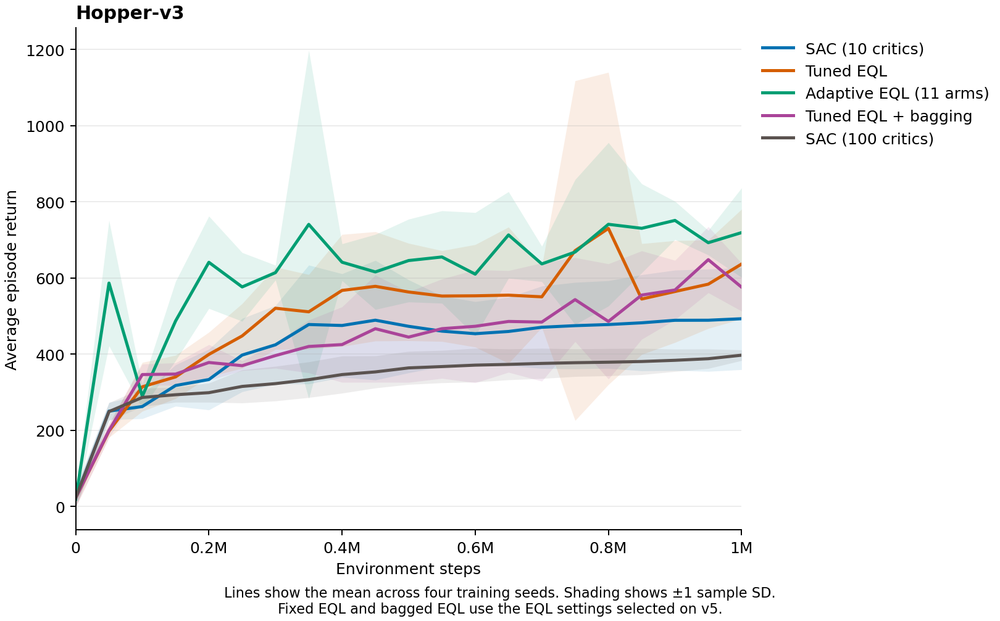
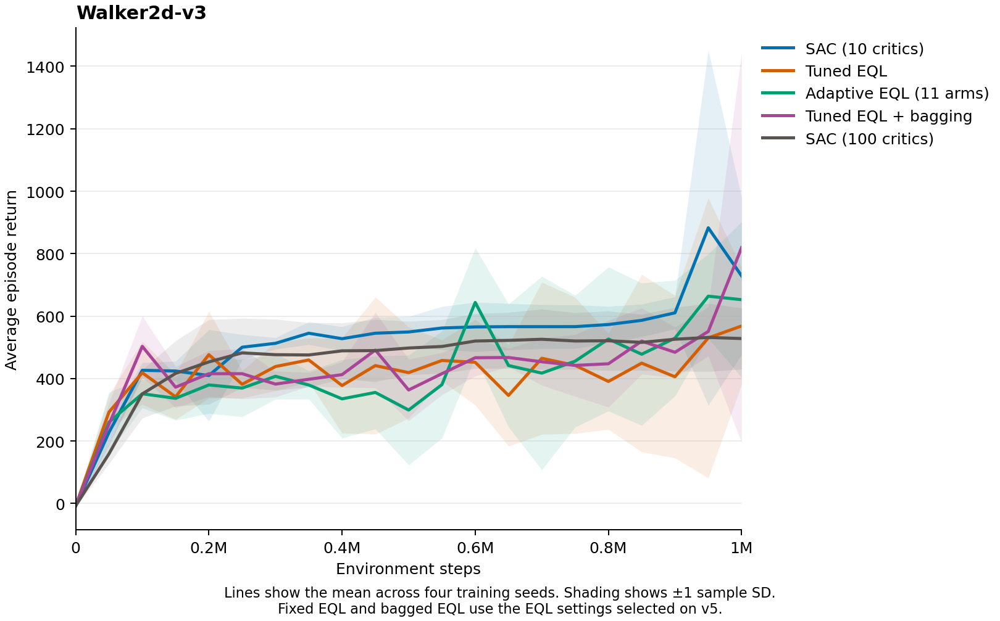

# Hopper 与 Walker2d 百万步实验

## 100 万步时的平均回报

| 方法 | Hopper-v3 | Walker2d-v3 |
|---|---:|---:|
| 历史 SAC（10 critics） | 492.89 ± 133.68 | 729.02 ± 251.96 |
| 固定 EQL | 636.59 ± 144.15 | 568.41 ± 187.49 |
| Adaptive EQL（11 个 actor 候选） | 719.21 ± 117.55 | 652.64 ± 249.16 |
| 固定 EQL + 一步分袋 | 575.85 ± 62.81 | 819.26 ± 624.83 |
| 在线 SAC-N（100 critics） | 397.09 ± 13.98 | 528.19 ± 97.75 |

每格给出四个训练 seeds（201–204）的均值和样本标准差。每个 seed 的分数取自 100 万步时的 128 个评估 episode。

## 完整学习曲线

### Hopper-v3

### Walker2d-v3

每条曲线从第 0 步起，每 5 万环境步评估一次，共 21 个点。实线是同一组四个 seeds 的平均回报，阴影是跨 seed 的一个样本标准差。

## 配置与数据

所有方法均使用 10 个并行训练环境，每个 seed 共收集 100 万条 transition，完成 99,796 次 critic 更新。

本轮使用 Gymnasium 0.29.1 注册的 v3 环境、MuJoCo 2.1.0 和 mujoco-py 2.1.2.14。

固定 EQL 和分袋 EQL 沿用此前在 v5 选定的 EQL 配置。两者学习率均为 0.0003。Hopper 使用 τ_Q=0.3、τ_a=0.7，Walker2d 使用 τ_Q=0.3、τ_a=0.5。分袋版每条 transition 分入两个袋。SAC 两组和 Adaptive EQL 的学习率为 0.001。

[汇总 CSV](summary.csv) · [全部学习曲线与逐 seed 数据](average_return.csv) · [双页 PDF](average_return.pdf)

每个环境和方法目录下的 `protocol.json` 保存配置与源文件哈希。各 seed 目录内的 `curve.json` 保存每个 episode 的原始回报和设备记录，`model.msgpack` 保存最终模型，`final.json` 保存终点回报和步数。
