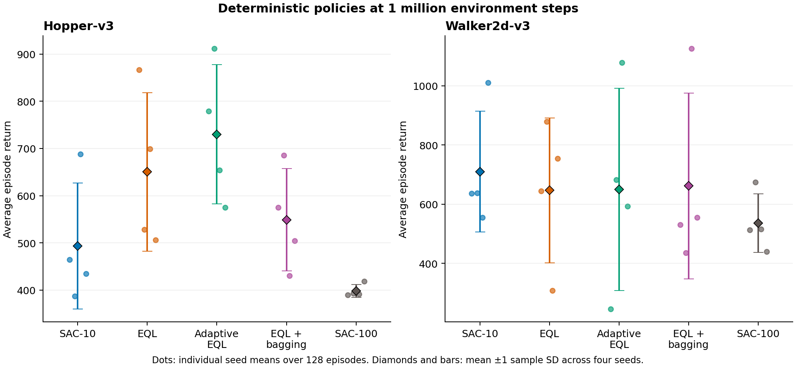
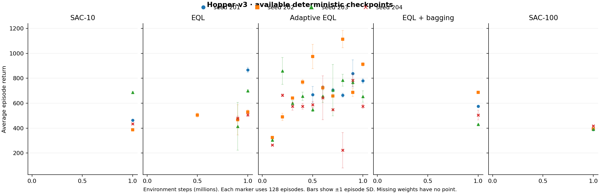
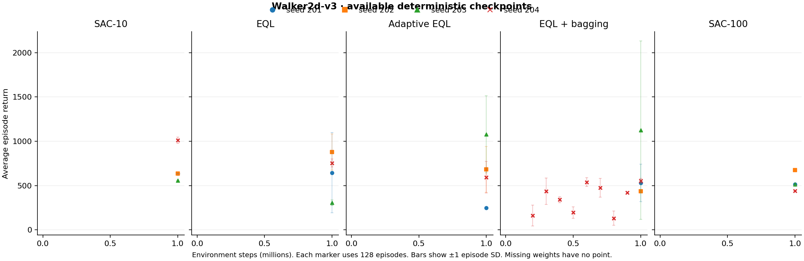

# v3 确定性策略重评

## 100 万步终点

| 方法 | Hopper-v3 | Walker2d-v3 |
|---|---:|---:|
| SAC (10 critics) | 493.36 ± 133.40 | 709.95 ± 204.36 |
| Tuned EQL | 650.25 ± 168.11 | 646.39 ± 245.14 |
| Adaptive EQL (11 arms) | 729.99 ± 147.60 | 649.73 ± 341.78 |
| Tuned EQL + bagging | 548.76 ± 108.61 | 661.52 ± 313.78 |
| SAC (100 critics) | 397.89 ± 13.66 | 535.74 ± 98.97 |

每个 seed 各执行 128 个完整 episode，表中 ± 为四个训练 seeds 之间的样本标准差。

## 可用中间点

共重评 84 个真实权重，其中 40 个是终点，其余 44 个是中间点。图中每个标记对应一个 seed 的一个检查点，误差线是该策略在 128 个 episode 内的总体标准差。缺少权重的位置留空。

## 评估口径

在 CPU 上读取 Rejax/Flax 的实际 actor 参数，以 tanh 变换后的高斯均值作为确定性动作，再裁剪到 [−1, 1]。直接使用训练所用的 Gymnasium 0.29.1 v3 环境和 MuJoCo 2.1.0。每个 episode 逐步执行，到 terminated 或 truncated 结束，累加未折扣的原始奖励。

沿用训练 seeds 201–204。每个 seed 经 NumPy master RNG 生成环境、动作和策略三个子种子，确定性动作无需使用策略种子。先给环境和动作空间设种子，再在 episode 开始时直接 reset()。每个名义评估点使用连续 128 次 reset 的初始状态。缺权重时只推进初始状态序列，从而保留各方法同一步数的配对。已逐 episode 校验该环境的 step 不消耗 reset 使用的随机数。

[全部评估点 CSV](checkpoints.csv) · [终点 CSV](summary.csv) · [图表 PDF](deterministic_evaluation.pdf)

每个 seed 目录中的 log.csv 使用 step、avg_ret、std_ret 三列，std_ret 按 128 个 episode 取 ddof=0。points 子目录保留逐 episode 的长度和回报。
