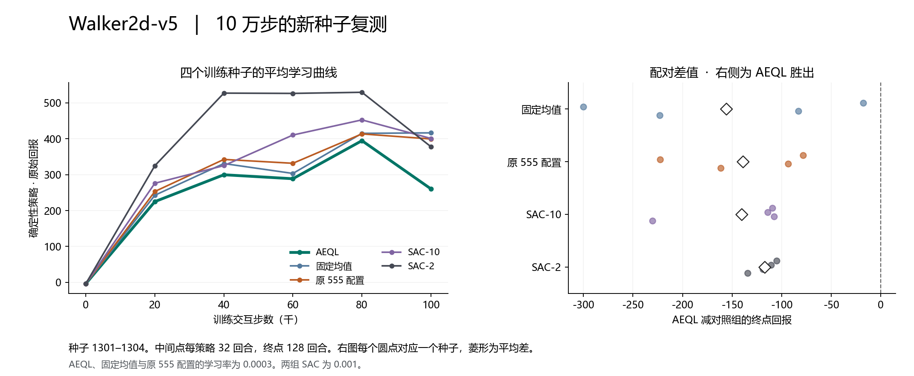
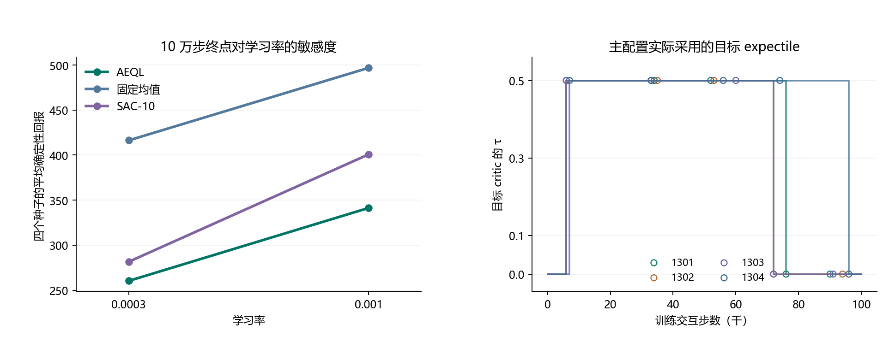

# Walker2d-v5：只调 critic expectile 的新种子复测

主配置 AEQL 在四个新训练种子上的 10 万步确定性回报为 260.34 ± 57.69。固定均值为 416.35 ± 121.24。同种子逐一配对，AEQL 四次均低于固定均值、原 555 配置、历史学习率的 SAC-10 及双 critic SAC。当前数据不支持稳定超越 SAC。

| 方法 | 学习率 | 确定性回报，均值 ± 跨种子 SD | 随机策略回报，均值 ± 跨种子 SD |
|---|---:|---:|---:|
| AEQL（主配置） | 0.0003 | 260.34 ± 57.69 | 300.00 ± 45.60 |
| 固定目标均值，actor min | 0.0003 | 416.35 ± 121.24 | 414.60 ± 98.93 |
| 原 555 配置，目标 τ=0.3、actor τ=0.5 | 0.0003 | 399.33 ± 76.32 | 402.33 ± 54.54 |
| SAC-10 | 0.001 | 400.75 ± 9.32 | 387.58 ± 12.42 |
| SAC-2 | 0.001 | 377.68 ± 48.02 | 378.39 ± 46.24 |
| AEQL | 0.001 | 341.27 ± 143.44 | 367.57 ± 96.64 |
| 固定目标均值，actor min | 0.001 | 496.83 ± 232.44 | 413.54 ± 125.12 |
| SAC-10 | 0.0003 | 281.61 ± 107.31 | 293.02 ± 68.99 |

在两个相同学习率下，AEQL 的确定性回报均值分别比固定均值低 156.02、155.56 分，胜出次数分别为 0/4、1/4；分别比相同学习率的 SAC-10 低 21.27、59.48 分，两次都是 2/4 胜。主配置的固定均值虽比历史学习率的 SAC-10 平均高 15.61 分，逐种子仅 1/4 胜出。历史 555.00 来源于 seeds 201–204 的随机策略评估，新种子同口径均值为 402.33。

## 控制器实际选择

候选 τ 为 0、0.1、0.3 和 0.5。主配置四个种子在 6,000–7,000 步的首次校准后全部选到 0.5，随后在 72,000–96,000 步回到 0。20 次已完成的校准均选择了两个端点之一。8 万步的平均回报是 394.60；对十万步也只取相同的前 32 个初始状态，平均回报为 258.96。校准依据是冻结策略上软回报的预测平方误差，控制器并未直接验证切换后策略训练的收益。固定均值从训练开始就使用 0.5，两条训练轨迹在晚期切换前已经不同，故此次对照无法单独估计晚期切换的因果效应。

## 预算与配对

共 8 个配置 × 4 个新种子。每次 100,000 条环境 transition、9,796 次 actor、critic 和温度更新。每个种子各方法使用同一块 GPU，1301/1303 为 Hyak RTX 2080 Ti，1302/1304 为 P100。Gymnasium 1.4.0、MuJoCo 3.17.0，10 个环境、共享 replay、γ=0.98，沿用历史时间截断掩码。除 SAC-2 外均为十 critic。训练预算包含校准用的全部交互。只读的最终评估另外运行确定性、随机策略各 128 回合。中间点用 32 个共同初始状态评估确定性策略，随机策略终点评估沿用历史评估器。

AEQL 和固定均值采用相同的冻结采样协议。在 5k、25k、45k、65k、85k 步尝试开启窗口，冻结行为策略、温度和校准用的目标网络；训练网络照常更新。每个并行环境跳过首个可能不完整的回合，保留随后两个完整回合，共 20 个回合。10 个回合选参，另 10 个回合验证相对当前规则的逐回合误差下降，超过一个配对标准误才切换。SAC 和原 555 配置保留原有实时采样。因此与固定均值的对照最能检验自适应本身的贡献。训练种子只有四个，配对表中的区间是探索性的配对 t 区间，未经多重比较校正。

[逐种子终点](seeds.csv) · [方法汇总](summary.csv) · [逐种子配对差](paired.csv) · [每个校准窗口](windows.csv) · [算法](../../critic_calibration.py) · [训练入口](../../run_walker_calibration.py) · [汇总与绘图](../../summarize_walker_calibration.py)
