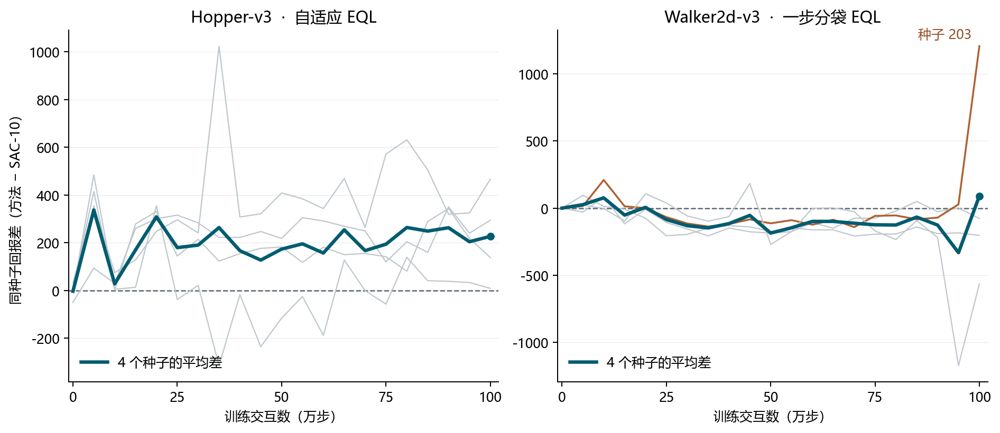

# EQL 在什么条件下能提高回报？

EQL 改变了多个 critic 对同一动作给出不同估值时的处理方式。项目中的 SAC-10 取十个估值的最小值，EQL 分别用 `τ_Q` 控制训练目标、用 `τ_a` 控制策略更新时的聚合。读这些实验，可以从三个问题入手。改变聚合规则本身能提高回报吗？给 critic 分配不同训练数据有额外收益吗？训练时自动选择 τ 能胜过固定规则吗？

在 Pendulum 的同学习率对照中，即使十个 critic 共享数据，改变 τ 也能提高回报。到了百万步连续控制，Hopper-v3 的自适应 EQL 相对 SAC-10 的优势贯穿训练曲线；Walker2d-v3 上，相同两种方法的排序反转。下面先建立可解释的基线，再区分分袋和自适应各自贡献了什么。[Pendulum 网格](../results/pendulum_tau_grid/summary.csv) · [百万步学习曲线数据](../results/million_hopper_walker_v3/average_return.csv)

## 1. 先让 EQL 复现 SAC，再单独改变 τ

原配置跑十万步，Pendulum 上固定 EQL 的平均回报为 −679.80，SAC 为 −1076.22。分别调参后，独立复测变成 SAC −185.05、EQL −584.67。两轮排序相反，而第二轮允许 SAC 搜学习率、EQL 则固定学习率 0.0003 搜 τ。因此，这组复测比较的是两套选参流程，单凭排名无法判断 expectile 的作用。[原配置终点](../results/original_comparison/summary.csv) · [四环境选参与复测](../results/search_four/summary.csv)

更直接的实验把两者的学习率都设为 0.001，固定十个 critic、共享 replay、训练预算和评估种子。先令 `τ_Q = τ_a = 0`，使两处聚合都精确取最小值。四个训练种子各评估 128 回合，**512 个回合的回报逐一复现 SAC**。以这个端点为起点，才可以考察单改一处聚合的影响。[精确端点记录](../results/pendulum_sac_endpoint/exact/) · [同种子 SAC 记录](../results/search_four/Pendulum-v1/SAC/)

| Pendulum-v1，十万步 | τ_Q | τ_a | 平均回报 | 相对双 min 的平均差 | 提高的种子 |
|---|---:|---:|---:|---:|---:|
| SAC 等价端点 | 0 | 0 | −185.05 | — | — |
| 只改策略更新 | 0 | 0.7 | −157.60 | +27.45 | 3/4 |
| 只改 critic 目标 | 0.3 | 0 | −157.52 | +27.53 | 3/4 |
| 两处同时改 | 0.3 | 0.7 | −151.72 | +33.33 | 4/4 |

两处单改都取得了大部分可见增益，同时修改又多约 6 分。八组非零组合的样本均值都高于双 min，说明观察到的方向不依赖某一个网格点。但候选排序和打分使用同四个种子，最优 τ 的取值仍需独立数据验证。这里能归因的是 **Pendulum 上，其他设置相同时放松最小值聚合可以提高平均回报**。[全部九组及逐种子差值](../results/pendulum_tau_grid/summary.csv)

## 2. 分袋确实降低 critic 误差相关性，但估值精度也付出了代价

如果多个 critic 总是一起高估或低估，给每个 critic 不同的训练样本，可能让误差相互抵消。早期四组对照已经提示，策略回报对这个改动的反应随任务变化。共享 target 时，分袋相对共享数据在 Pendulum 上约高 0.63 分，在 Reacher 上低 9.66 分。于是下一轮直接测 critic 的误差，而不再从回报反推机制。[早期四组对照](../results/online_v1/summary.csv)

在 Pendulum 固定 `τ_Q = 0.1`、`τ_a = 0.7` 和学习率 0.001，让每个最终模型在同一批 336 个状态动作上预测。每个查询用该模型自己的冻结策略模拟 256 次，估计参考软 Q。下表取十个 critic、四个训练种子的均值。“共同低估”指随机取一对 critic，两者均低于参考值的比例。[诊断设计与逐种子记录](../results/pendulum_critic_errors/RESULTS_zh.md)

| Replay 方式 | 误差相关性 | 共同低估 | 单 critic RMSE | 策略回报 |
|---|---:|---:|---:|---:|
| 共享数据 | 0.9876 | 90.1% | 36.16 | −151.94 |
| 一步分袋 | 0.9776 | 93.3% | 46.87 | −153.68 |
| 整回合分袋 | 0.9740 | 95.8% | 55.55 | −155.97 |

扩展到 20 和 50 个 critic 时，两种分袋相对共享 replay 的误差相关性在每个规模的四个种子上都下降，但共同低估比例和 RMSE 的组均值都上升。**critic 的误差可以变得较少同步，同时整体更偏低。** 因此，“去相关”这一机制得到验证，把它用作选算法的唯一指标却会在这里选错。各模型有各自的策略，参考软 Q 也随之变化，这项诊断本身无法证明低估导致了回报差。[按规模的指标](../results/pendulum_critic_errors/summary.csv) · [同种子相关性差](../results/pendulum_critic_errors/paired.csv)

单纯增大 ensemble 同样受任务限制。在线 SAC 用同一张 A40、同一预算从 10 个 critic 扩到 100 个，Walker2d-v5 平均提高 52.08 分，四个种子都提高；Pendulum、Reacher 和 Hopper-v5 的均值均下降。增大 critic 数还会增加总计算量。先前的显存短测回答的是能否运行该规模，效果要由这些回报对照判断。[SAC-100 对 SAC-10 的配对结果](../results/online_sacn100_a40/summary.csv) · [容量短测](../results/pendulum_capacity/)

## 3. 百万步训练中，哪些终点优势也出现在学习曲线上？

Hopper-v3 和 Walker2d-v3 各有五种方法、四个相同编号的训练种子。每个种子训练 100 万步，每 5 万步用随机策略评估 128 回合。下表同时报告终点和整个预算内的表现。**全程平均差**先对每个种子在 0 至 100 万步的 21 个评估点做梯形积分，除以 100 万步，再对四个种子取均值。两列都保留原始回报单位，正值表示前一种方法更高。[逐种子学习曲线](../results/million_hopper_walker_v3/average_return.csv) · [终点核验](../results/million_hopper_walker_v3/summary.csv)

| 环境与对照 | 终点平均差 | 终点胜出种子 | 全程平均差 | 全程胜出种子 |
|---|---:|---:|---:|---:|
| Hopper-v3，自适应 EQL − SAC-10 | +226.32 | 4/4 | +199.65 | 4/4 |
| Walker2d-v3，自适应 EQL − SAC-10 | −76.38 | 2/4 | −108.70 | 1/4 |
| Walker2d-v3，一步分袋 EQL − SAC-10 | +90.24 | 1/4 | −92.30 | 0/4 |

细线为四个训练种子，粗线为平均差，虚线表示两种方法持平。两幅图的纵轴刻度不同。每幅图的各个评估点来自相同的四对训练轨迹，独立重复以训练种子计。

**Hopper 的收益同时体现在终点和训练过程。** 自适应 EQL 与 SAC-10 的终点均值分别为 719.21 和 492.89。改用确定性动作重评同一批权重，均值仍为 729.99 对 493.36，配对胜出次数由 4/4 变为 3/4。20 个训练后评估点上，自适应组的四种子均值均高于 SAC-10。这些时间点来自同四条训练轨迹。这四个种子的随机终点增益从 +8.46 到 +465.72 分，适合报告方向和幅度，精确估计跨种子平均效应仍需更多重复。该方法在训练中选择 actor 的 τ 并调整 critic 的 τ，观察到的收益属于这套配置。固定 EQL 的学习率为 0.0003，自适应 EQL 和 SAC-10 为 0.001，因此自适应相对固定 EQL 的 82.62 分终点差中，控制器的独立贡献还未分离。[训练配置](../results/million_hopper_walker_v3/README.md) · [确定性重评](../results/million_hopper_walker_v3/deterministic_eval/summary.csv)

**Walker2d 的分袋结果展示了均值会掩盖什么。** 种子 203 上，分袋 EQL 比 SAC-10 高 1206.48 分，其余三个种子分别低 77.44、203.04 和 565.05 分。若问题改成“在相同固定 EQL 上增加分袋会怎样”，终点平均差为 +250.85，四个种子中两个提高。确定性重评又使 SAC-10 的均值高于分袋 EQL（709.95 对 661.52）。一次高回报轨迹值得研究，但这批数据不足以把分袋列为 Walker2d 的默认改进。[随机策略终点](../results/million_hopper_walker_v3/summary.csv) · [同权重确定性终点](../results/million_hopper_walker_v3/deterministic_eval/summary.csv)

## 4. 把学习率和采样方式固定后，自动调 τ 还有多少收益？

前面的 Hopper 对照留下了一个归因问题。把 actor 的候选从五档增加到十一档后，三个短程任务的均值都上升，但 Hopper-v5 和 Walker2d-v5 各只有两个种子提高。Pendulum 的五档自适应回报为 −153.24，同批种子上最好的固定组合为 −151.72。增加选择范围有时能抬高样本均值，这些实验尚不足以说明动态选择优于一个选得好的固定值。[五档与十一档配对](../results/adaptive_tasks_11arms_rtx6000/summary.csv) · [Pendulum 自适应结果](../results/adaptive_pendulum/summary.json)

Walker2d-v5 的后续实验把问题缩小到 critic：actor 始终取 min，自适应组用冻结策略轨迹选择目标 τ，固定组始终用均值（τ = 0.5）。两组采用相同的冻结采样协议，每个配置在四个新种子上训练十万步，各自使用两个学习率。这里比较的是 **critic 校准规则**，与上一节同时调整 actor 和 critic 的算法是两种不同设计。[校准协议与逐种子结果](../results/walker_calibration/RESULTS_zh.md)

| 学习率 | 自适应目标，确定性回报 | 固定均值，确定性回报 | 配对平均差 | 自适应胜出 |
|---|---:|---:|---:|---:|
| 0.0003 | 260.34 | 416.35 | −156.02 | 0/4 |
| 0.001 | 341.27 | 496.83 | −155.56 | 1/4 |

换成随机策略评估，两个学习率的配对均值差仍为负，分别为 −114.60 和 −45.96。主配置的四个种子在首次校准后都选了 0.5，随后又回到 0。控制器选择 τ 的依据是冻结策略的软回报预测误差，最终评价的是继续训练后的策略回报。就这两个学习率和四个新种子而言，固定均值是更好的对照策略。若要判断晚期切换本身是否有害，需要从同一切换前权重分叉，分别继续使用 0.5 和切到 0。[逐种子配对差](../results/walker_calibration/paired.csv) · [切换记录](../results/walker_calibration/windows.csv)

## 证据边界与下一项对照

Hopper-v3 是最值得复核自适应收益的环境。最有辨别力的下一项实验，是让固定 τ 与自适应 τ **都使用 0.001 的学习率**，统一采样协议、训练预算和评估动作，在新种子上事先约定同时看终点与全程平均回报。它将回答当前百万步对照留下的问题：固定配置获得同样条件后，自适应还剩多少增益？Walker2d 已有的负向校准结果和 Pendulum 的分袋诊断，则给出了保留固定均值与共享 replay 作为对照的实证理由。

外部基线仍有值得跟踪的信号。仓库中 CGPO 在 20 万步、种子 201 的 128 回合配对评估均值为 Hopper-v3 **3492.52**、Walker2d-v3 **2653.73**。这是一个训练种子；EQL 的确定性重评表也缺少该种子的同预算 20 万步对照。现有记录适合报告检查点成绩，跨方法的稳定排名仍需相同步数、评估协议和多个配对训练种子。v5 的百万步续训也是阶段快照，本报告使用完整的 v3 终点作长程判断。[Hopper 的 CGPO 评估](../results/cgpo_a100_v3/Hopper-v3/seed201/eql_eval/0200000.json) · [Walker2d 的 CGPO 评估](../results/cgpo_a100_v3/Walker2d-v3/seed201/eql_eval/0200000.json) · [EQL 重评检查点](../results/million_hopper_walker_v3/deterministic_eval/checkpoints.csv) · [v5 续训记录](../results/million_hopper_walker/)

[按早期实验查找细节](README.md) · [全部算法、实验目录与复现入口](../README.md) · [原始文件校验清单](文件清单.csv)
