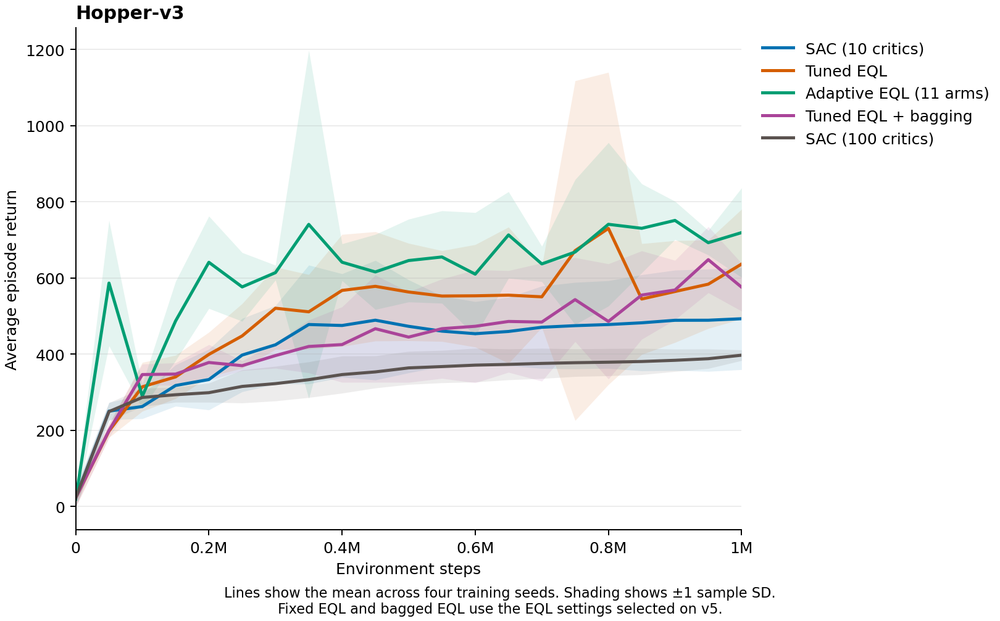

# 连续控制实验报告

**归档日期为 2026-11-18。** 百万步主对照覆盖 Hopper-v3、Walker2d-v3，各有 5 个方法 × 4 个训练种子。另存有 10 万步调参、ensemble 与分袋实验，以及 v5 和 CGPO 的阶段记录。[原始数据目录](../results/) · [文件清单](文件清单.csv)

## 100 万步终点

每个 seed 收集 1,000,000 条 transition，更新 critic 99,796 次。随机策略评估 128 个完整 episode，每回合分数为未折扣环境奖励之和。先对每个 seed 的 128 个回合取平均，再对 seeds 201–204 等权取均值。± 为四个训练种子间的样本标准差。

| 方法 | Hopper-v3 | Walker2d-v3 |
|---|---:|---:|
| SAC，10 critics | 492.89 ± 133.68 | 729.02 ± 251.96 |
| 固定 τ 的 EQL | 636.59 ± 144.15 | 568.41 ± 187.49 |
| 自适应 EQL，11 个候选 | **719.21 ± 117.55** | 652.64 ± 249.16 |
| 固定 τ 的 EQL，一步分袋 | 575.85 ± 62.81 | **819.26 ± 624.83** |
| SAC，100 critics | 397.09 ± 13.98 | 528.19 ± 97.75 |

Hopper 上，自适应 EQL 在四个配对种子都超过 SAC-10。Walker2d 上，分袋 EQL 仅在 seed 203 超过 SAC-10，该种子得分 1752.94，其余三次为 555.46、431.82 和 536.81。确定性重评时，Walker2d 的最高均值转为 SAC-10 的 709.95。重评使用同一批训练权重，覆盖 40 个终点及 44 个中间检查点。[逐 seed 终点](../results/million_hopper_walker_v3/summary.csv) · [确定性重评协议与结果](../results/million_hopper_walker_v3/deterministic_eval/README.md)

## 10 万步时，自适应 τ 和扩大 ensemble 各有多少收益

下表为每种方法四个种子的最终平均回报。每个种子训练 100,000 步、更新 9,796 次、最终评估 128 回合。SAC 两列均为项目的在线实现，使用共享 replay 和全部 critic 的最小值，在同一张 A40 上运行。

| 环境 | 自适应 EQL，5 档 | 自适应 EQL，11 档 | SAC-10 | SAC-100 |
|---|---:|---:|---:|---:|
| Pendulum-v1 | −153.24 | 未运行 | −185.05 | −571.66 |
| Reacher-misc | 36.07 | 37.24 | 46.43 | 36.72 |
| Hopper-v5 | 302.80 | 337.39 | 329.46 | 279.92 |
| Walker2d-v5 | 317.57 | 333.78 | 404.89 | 456.97 |

Pendulum 使用 10 个 critic、共享 replay，α 初值为 1 并按目标熵自动更新。五档自适应的 −153.24 ± 12.89 接近同批种子挑出的固定 τ 最佳值 −151.72 ± 11.96。已跑的 τ_Q 初值为 0.5，从任意初值收敛到最优 τ 的猜想仍待检验。[自适应协议](../results/adaptive_pendulum/protocol.json) · [固定 τ 搜索](../results/pendulum_tau_grid/RESULTS_zh.md)

增加到 11 档后，三个环境的均值都提高，但 Hopper 和 Walker2d 各只有 2/4 个种子提高。SAC 从 10 个 critic 增至 100 个时，四环境中仅 Walker2d-v5 的均值提高，四个配对种子均提高。[自适应配对表](../results/adaptive_tasks_11arms_rtx6000/COMPARISON_zh.md) · [SAC 配对表](../results/online_sacn100_a40/COMPARISON_zh.md) · [冻结 critic 的误差诊断](../results/ensemble_sacn_diagnostic/RESULTS_zh.md)

## 两组阶段记录

Hyak 文件按运行目录依次复制，采集结束于美国太平洋时间 19:24:42。下表列出快照中已写盘的进度和评估点。[采集时间](../provenance/snapshot_time.txt)

| 实验 | 已归档的训练进度 | 可用于比较的分数 |
|---|---|---|
| Hopper-v5 百万步续训 | seed 201，分袋 EQL 800k、SAC-100 270k | 两条均有中间记录 |
| Walker2d-v5 百万步续训 | SAC-10 seed 201 达 1M、seed 202 达 340k；固定 EQL seed 201 达 340k | 唯一百万步终点为 SAC-10 seed 201，763.22 |
| CGPO，Hopper-v3 | seed 201，38k | 原生 30k 评估 10 回合，均值 299.34 |
| CGPO，Walker2d-v3 | seed 201，37k | 原生 30k 评估 10 回合，均值 227.88 |

CGPO 的配对评估每 50k 步运行 128 回合，快照中两个环境均只有第 0 步配对评估。表中两项 30k 回报使用 CGPO 的原生口径。v3、v5、训练预算与动作选择都会影响回报，应对齐后再比较。[v5 原始记录](../results/million_hopper_walker/) · [CGPO 逐回合数据](../results/cgpo_a100_v3/) · [CGPO 实跑代码](../provenance/cgpo_a100_v3/src/)

## 目录索引

| 实验范围 | 数据与报告 |
|---|---|
| 四组实现、原配置基线 | [四组实现](../results/online_v1/) · [三方法基线](../results/original_comparison/) |
| 四环境搜索与独立复测 | [候选、协议与逐 seed 记录](../results/search_four/) |
| Pendulum 的 SAC 等价端点和固定 τ | [端点](../results/pendulum_sac_endpoint/) · [九组 τ](../results/pendulum_tau_grid/) |
| 显存、分袋和 critic 误差 | [容量短测](../results/pendulum_capacity/) · [整回合分袋](../results/pendulum_episode_bags/) · [误差与相关性](../results/pendulum_critic_errors/) |
| 自适应 τ | [Pendulum](../results/adaptive_pendulum/) · [其他三环境五档](../results/adaptive_tasks_rtx6000/) · [十一档](../results/adaptive_tasks_11arms_rtx6000/) |
| 在线 SAC-N | [10 critics](../results/online_sacn10_a40/) · [100 critics](../results/online_sacn100_a40/) · [冻结模型诊断](../results/ensemble_sacn_diagnostic/) |
| 百万步训练和重评 | [v5](../results/million_hopper_walker/) · [v3](../results/million_hopper_walker_v3/) · [历史备份](../results/million_hopper_walker_v3_backups/) |
| 在线扩散策略 | [CGPO](../results/cgpo_a100_v3/) |
| 早期实验的详细说明 | [九章实验汇编](README.md) |
| 复现与续训 | [按运行保存的脚本及日志](../provenance/) · [训练状态与历史权重](../大文件/README.md) |
